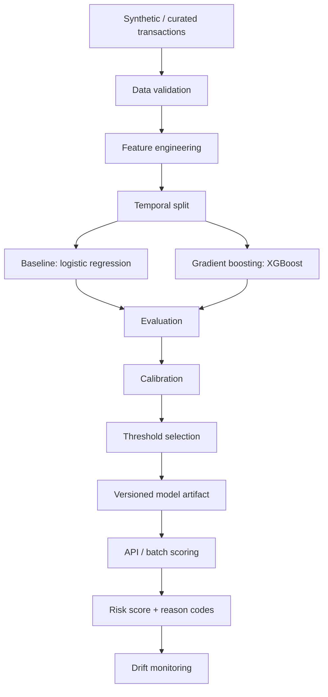
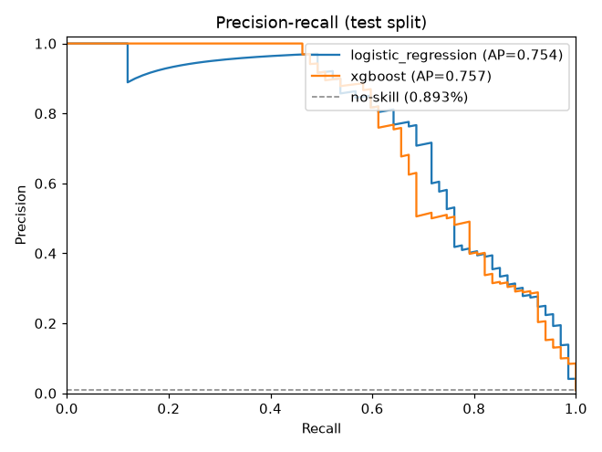
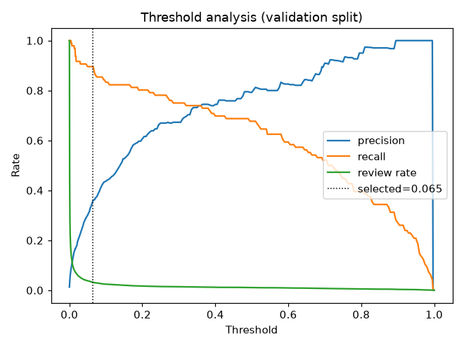

# Fraud Detection ML

A production-style educational fraud risk scoring and decision-support system for synthetic
financial transactions.

The project demonstrates temporal validation, leakage-safe feature engineering, severe
class-imbalance handling, calibrated risk scoring, threshold optimisation, operational
review-rate analysis, model explainability and monitored API inference.

> **Disclaimer.** This project is an independent educational implementation using synthetic
> financial data. It is designed to demonstrate fraud risk scoring and ML engineering
> concepts and is not intended for production fraud decisioning, regulatory compliance, or
> autonomous blocking of transactions.

[](https://github.com/Adetlo/fraud-detection-ml/actions/workflows/ci.yml)


**At a glance:** versioned input/output contracts · seeded synthetic generator with ten
fraud-like patterns · point-in-time history features with tested no-future guarantees ·
temporal 70/15/15 split · one feature pipeline for training and inference · logistic
baseline vs XGBoost · guarded calibration · policy-driven threshold with review-rate ceiling
and illustrative cost model · reason codes · hash-verified versioned artifacts · FastAPI
scoring with structured errors and correlation ids · batch scoring · PSI drift reports ·
170 tests at 97% coverage · Docker and CI.

## Contents

1. [Overview](#1-overview)
2. [Why this project exists](#2-why-this-project-exists)
3. [Relationship to portfolio](#3-relationship-to-portfolio)
4. [Architecture](#4-architecture)
5. [ML problem formulation](#5-ml-problem-formulation)
6. [Synthetic dataset](#6-synthetic-dataset)
7. [Leakage prevention](#7-leakage-prevention)
8. [Feature engineering](#8-feature-engineering)
9. [Temporal validation](#9-temporal-validation)
10. [Models](#10-models)
11. [Class imbalance](#11-class-imbalance)
12. [Evaluation metrics](#12-evaluation-metrics)
13. [Threshold tuning](#13-threshold-tuning)
14. [Cost-sensitive evaluation](#14-cost-sensitive-evaluation)
15. [Explainability](#15-explainability)
16. [Model versioning](#16-model-versioning)
17. [Drift monitoring](#17-drift-monitoring)
18. [API](#18-api)
19. [CLI](#19-cli)
20. [Demo](#20-demo)
21. [Testing](#21-testing)
22. [Security](#22-security)
23. [Model governance](#23-model-governance)
24. [Limitations](#24-limitations)
25. [Roadmap](#25-roadmap)
26. [Disclaimer](#26-disclaimer)

## 1. Overview

`fraud-ml` takes a transaction plus the point-in-time context an upstream process knew
about the account, validates it against a versioned contract, derives 37 features through
one deterministic pipeline, and returns a **fraud risk probability**, a **risk band**
(LOW / MEDIUM / HIGH / CRITICAL), a **decision-support label** (PASS / REVIEW /
PRIORITY_REVIEW) and **reason codes**. Training compares a transparent baseline with a
gradient-boosting model on a temporal split, selects a threshold from an operational policy,
and persists model, preprocessing, policy and lineage as one hash-verified artifact. A
FastAPI service and a batch scorer load that artifact; PSI-based drift checks compare any
two periods.

Quick start:

```bash
uv sync
uv run fraud-ml demo            # ~8 s: generate 50k rows -> train -> evaluate -> score -> drift
uv run fraud-ml serve           # API on http://127.0.0.1:8000 (docs at /docs)
```

## 2. Why this project exists

Fraud detection is where "model.fit()" meets money, capacity and accountability. A
portfolio project in this domain has to show more than a classifier: it has to show that
the evaluation is not leaking the future, that 99% accuracy means nothing, that a threshold
is a business decision, that 40% of transactions cannot go to review, that a score needs a
reason a reviewer can read, that an artifact must say what produced it, and that the
system must notice when the world changes. This repository is that argument, written in
code, tests and documents.

## 3. Relationship to portfolio

```
corebank-ledger          synthetic financial activity (double-entry ledger)
      |
txn-data-pipeline        validated, curated transaction data (financial-transaction/1)
      |
fraud-detection-ml       fraud risk score + explanation + decision-support output
```

[corebank-ledger](https://github.com/Adetlo/corebank-ledger) produces synthetic activity,
[txn-data-pipeline](https://github.com/Adetlo/txn-data-pipeline) validates and curates it,
and this project scores it. The link is conceptual: this repository is independently
runnable, defines its own contract (`fraud-transaction/1`), ships its own generator and
sample data, and offers an optional adapter (`fraud_ml.adapters.txn_pipeline`) that maps
the pipeline's curated Parquet shape onto the contract. See
[docs/DATA_CONTRACT.md](docs/DATA_CONTRACT.md).

## 4. Architecture



```
src/fraud_ml/
├── contracts/    transaction (input), score (output), enums, money
├── data/         loader, validation, temporal split, synthetic generator
├── features/     definitions, transaction, temporal, velocity (history), behavioural, pipeline
├── models/       baseline, gradient_boosting, calibration, serialization, registry
├── training/     train, evaluation, threshold, experiment (MLflow)
├── scoring/      scorer, explanation (reason codes), batch
├── monitoring/   drift, score_distribution, data_quality
├── api/          routes, dependencies, errors
├── adapters/     txn_pipeline
├── cli/          main (Typer)
├── config.py · logging.py · exceptions.py · main.py (ASGI)
tests/            unit · property · integration · api · e2e
docs/             ARCHITECTURE · DATA_CONTRACT · FEATURE_ENGINEERING · MODEL_EVALUATION ·
                  THRESHOLDING · EXPLAINABILITY · DRIFT · MODEL_GOVERNANCE · SECURITY ·
                  PERFORMANCE · ADR/
```

Stack: Python 3.12, pandas, NumPy, scikit-learn, XGBoost, Pydantic v2, FastAPI, Typer,
MLflow (local file store), joblib, PyArrow, matplotlib, structlog; pytest, Hypothesis,
ruff, mypy (strict), bandit, pip-audit; uv; Docker; GitHub Actions. Details in
[docs/ARCHITECTURE.md](docs/ARCHITECTURE.md).

## 5. ML problem formulation

* **Unit:** one transaction with point-in-time account context.
* **Target:** synthetic `is_fraud` (about 1% positive).
* **Output:** a risk probability ranked for review prioritisation; decisions are
  recommendations for a human or downstream control, never autonomous blocks.
* **Primary metric:** PR-AUC; operating point chosen by recall target, review-rate ceiling
  and illustrative cost.
* **Validation:** temporal; everything that tunes sees the validation period only.
* **Serving:** online (single and small batch via HTTP) and offline (Parquet/JSONL/CSV).

## 6. Synthetic dataset

`fraud-ml generate-data --transactions 50000 --fraud-rate 0.01 --seed 42` builds a
reproducible dataset (same seed, same bytes): 1,250 accounts with segment, home country and
currency, activity rate, typical amount, preferred hours, known counterparties and devices,
and optional quiet periods; legitimate transactions across seven currencies, seven channels
and seven transaction types, including legitimate large payments, new beneficiaries,
night-owl accounts, travel and new phones; and ten injected fraud-like patterns:

| # | Pattern | Synthetic label |
|---|---|---|
| 1 | rapid transaction velocity (burst of online purchases at new merchants) | CARD_NOT_PRESENT |
| 2 | unusually high amount | ACCOUNT_TAKEOVER |
| 3 | new beneficiary + large payment | ACCOUNT_TAKEOVER |
| 4 | cross-border anomaly | CARD_NOT_PRESENT |
| 5 | dormant account suddenly active | ACCOUNT_TAKEOVER |
| 6 | many counterparties in a short period | MULE_ACTIVITY |
| 7 | repeated near-threshold payments | STRUCTURING |
| 8 | behaviour shift (unusual channel, hour and device) | ACCOUNT_TAKEOVER |
| 9 | unusual transaction time | CARD_NOT_PRESENT |
| 10 | rapid movement of incoming funds | RAPID_MOVEMENT |

Fifteen percent of events are "mild" instances, and every pattern overlaps with legitimate
behaviour, so no feature is a copy of the label. History fields are derived from the raw
event log through the same point-in-time routine the adapter uses. Labels are generator
conventions, not regulatory definitions. Demo dataset: 50,000 rows, 501 fraud rows (1.00%),
2025-01-01 to 2025-06-30.

## 7. Leakage prevention

| Control | Mechanism |
|---|---|
| no future information | history features use strictly earlier rows of the account (`compute_history_features`); feature derivation is row-wise |
| no label in the matrix | `FORBIDDEN_COLUMNS`; the feature step raises `LeakageError` if `is_fraud` / `fraud_type` reach it |
| no post-investigation fields | `POST_OUTCOME_COLUMNS` (`investigation_outcome`, `chargeback_flag`, `analyst_decision`, …) are rejected on input |
| no label-derived aggregates | no statistic is computed from the label anywhere |
| no random final split | `temporal_split` is the only split |
| preprocessing fitted on train only | the `ColumnTransformer` is fitted inside training on the training period; tests assert learned categories and scaler statistics come from it |
| no identifiers as features | `ID_COLUMNS` forbidden |

Each row of this table has a test in `tests/unit/test_leakage.py`, `tests/unit/test_history.py`
or `tests/property/test_properties.py`. See the *Leakage Controls* section of
[docs/FEATURE_ENGINEERING.md](docs/FEATURE_ENGINEERING.md).

## 8. Feature engineering

37 features, `features/1`:

* **Transaction:** `log_amount` (reference units), `amount_band`, `threshold_proximity`,
  `near_threshold_flag`, `currency`, `transaction_type`, `channel`, `country`,
  `beneficiary_country`, `merchant_category`, `ip_risk_band`, `customer_segment`
* **Temporal:** `hour_of_day`, `day_of_week`, `hour_sin`, `hour_cos`, `unusual_hour_score`,
  `is_weekend`, `is_night`
* **Velocity:** `transactions_1h`, `transactions_24h`, `log1p_amount_1h`, `log1p_amount_24h`,
  `unique_counterparties_24h`, `velocity_ratio_1h_24h`, `amount_vs_inflow_24h`,
  `inflow_present_24h`
* **Behavioural:** `amount_vs_account_median`, `amount_vs_account_mean`,
  `log1p_days_since_last`, `log1p_account_age_days`, `has_history`, `new_beneficiary_flag`,
  `new_device_flag`, `cross_border_flag`, `dormant_flag`, `new_account_flag`

One pipeline: `FunctionTransformer(build_feature_frame)` -> `ColumnTransformer` (median
imputation, scaling for the linear model, one-hot with an explicit *infrequent* bucket for
open vocabularies) -> estimator, persisted as a single object. Training and inference
cannot drift apart because there is only one implementation.

## 9. Temporal validation

Rows are ordered by timestamp and cut 70 / 15 / 15: train 2025-01-01 to 05-08 (35,000
rows, 338 positives), validation to 06-04 (7,500 rows, 96 positives), test to 06-30
(7,500 rows, 67 positives). Early stopping, calibration, threshold and winner selection use
validation; test is scored once. Account overlap across periods is intentional and safe
because no feature reads later rows ([ADR 0001](docs/ADR/0001-temporal-split-over-random.md)).

## 10. Models

| | Baseline | Advanced |
|---|---|---|
| estimator | `LogisticRegression(class_weight="balanced", C=0.5)` | `XGBClassifier(hist, depth 3, lr 0.05, subsample 0.8, scale_pos_weight=sqrt(neg/pos))` |
| preprocessing | shared pipeline, scaled | shared pipeline, unscaled |
| model selection | — | early stopping on validation (`aucpr`, 40 rounds); 205 trees on the demo |
| calibration | measured; Platt kept only if it helps | same |

The baseline is mandatory ([ADR 0003](docs/ADR/0003-logistic-regression-baseline.md)); the
winner is chosen on validation PR-AUC with an operational override
([ADR 0004](docs/ADR/0004-gradient-boosting-primary-model.md)).

## 11. Class imbalance

At 1% positives, accuracy is 99% for a model that flags nothing. Imbalance is handled by
class weighting (baseline) and square-root positive weighting (XGBoost), by evaluating with
PR-AUC, precision and recall instead of accuracy, by selecting the threshold on recall and
review capacity rather than at 0.5, and by measuring calibration because weighting distorts
probabilities. Isotonic calibration is explicitly guarded: with fewer than 500 validation
positives it overfits the ranking (observed 0.03 to 0.08 test PR-AUC loss), so it is skipped.

## 12. Evaluation metrics

Demo run, seed 42, 50,000 rows (every number below comes from `reports/demo/metrics.json`):

| Metric | LR validation | LR test | XGBoost validation | XGBoost test |
|---|---:|---:|---:|---:|
| PR-AUC | 0.667 | 0.754 | **0.786** | 0.757 |
| ROC-AUC | 0.989 | 0.992 | 0.991 | 0.992 |
| precision | 0.335 | 0.272 | 0.360 | 0.326 |
| recall | 0.917 | 0.925 | 0.896 | 0.836 |
| F1 | 0.490 | 0.420 | 0.513 | 0.469 |
| Brier score | 0.0067 | 0.0041 | 0.0052 | 0.0041 |
| review rate | 3.51% | 3.04% | 3.19% | 2.29% |
| alerts per 1,000 | 35.1 | 30.4 | 31.9 | 22.9 |
| expected illustrative cost | 1,763 | 1,392 | 1,851 | 1,736 |

Selected model: **XGBoost** (validation PR-AUC 0.786 vs 0.667, lower review rate). Test
confusion matrix at threshold 0.065: TP 56, FP 116, FN 11, TN 7,317.

Honest reading: on the test period the two models are statistically indistinguishable
(67 positives, roughly ±0.05 PR-AUC), and the baseline reaches higher recall at a slightly
higher review rate. ROC-AUC above 0.99 for both says little under this imbalance; the
precision-recall curve is the picture that matters. Segment performance (currency, channel,
transaction type, domestic vs cross-border) is in `reports/demo/segment_metrics.csv`; it is
segment performance, not a fairness analysis. Details and plots in
[docs/MODEL_EVALUATION.md](docs/MODEL_EVALUATION.md).

<p>


</p>

## 13. Threshold tuning

The threshold is a policy, not 0.5. Candidates are swept on validation; the policy keeps
those with recall >= 0.80 and review rate <= 5%, then picks the lowest illustrative cost.
A priority threshold (first point at precision >= 0.75) separates REVIEW from
PRIORITY_REVIEW. Demo: threshold 0.065, priority threshold 0.41, bands LOW < 0.0325 <=
MEDIUM < 0.065 <= HIGH < 0.41 <= CRITICAL; policy satisfied. If the policy cannot be
satisfied the run says so. [docs/THRESHOLDING.md](docs/THRESHOLDING.md).

## 14. Cost-sensitive evaluation

`expected_cost = FN x 100 + FP x 5 + TP x 1` by default (`FRAUD_ML_FALSE_NEGATIVE_COST`,
`FRAUD_ML_FALSE_POSITIVE_COST`, `FRAUD_ML_TRUE_POSITIVE_COST`). The values are
**illustrative synthetic units**, not real loss estimates; they make the trade-off between
missed fraud and wasted reviews explicit and configurable. `review_rate` and
`alerts_per_1000` report operational load alongside.

## 15. Explainability

Every score carries up to five **reason codes**: rule-based risk indicators such as
`HIGH_AMOUNT_VS_HISTORY`, `HIGH_VELOCITY_1H`, `NEW_BENEFICIARY`, `CROSS_BORDER`,
`UNUSUAL_HOUR`, `DORMANT_ACCOUNT_REACTIVATED`, `MANY_COUNTERPARTIES_24H`,
`NEAR_THRESHOLD_AMOUNT`, `NEW_DEVICE`, `HIGH_RISK_IP`, `RAPID_OUTFLOW_AFTER_INFLOW`,
`NEW_ACCOUNT`, with documented thresholds. They describe which risk signals are present;
they are **not** causal explanations of the model output. Model-side attribution is
reported separately as XGBoost gain importance (top: `velocity_ratio_1h_24h` 9.6%,
`new_beneficiary_flag` 8.3%, `new_device_flag` 4.5%) and optional permutation importance
over contract columns. SHAP was left out on purpose.
[docs/EXPLAINABILITY.md](docs/EXPLAINABILITY.md).

## 16. Model versioning

`models/<run_id>/model.joblib` + `metadata.json` with `model_version`, `run_id`,
`schema_version`, `feature_version`, `score_schema_version`, `training_timestamp`,
`training_data_version` (SHA-256 of the source), `git_commit`, `seed`, `library_versions`,
`training_config`, `feature_names`, `policy` (threshold, priority threshold, band bound),
`calibration_method`, validation/test/baseline metrics, `selection_rationale`,
`split_summary` and `artifact_sha256`. `models/latest/` is an explicit promotion. Loading
fails safely on a missing or tampered hash, an unsupported schema, a different feature
version or a different score contract. MLflow (local file store) records parameters,
metrics, reports and metadata per run.
[ADR 0007](docs/ADR/0007-versioned-model-artifacts.md).

## 17. Drift monitoring

`fraud-ml drift-check --reference A --current B [--model models/latest]` computes PSI for
11 numeric and 10 categorical inputs and, with a model, for the score distribution:
< 0.10 OK, 0.10-0.25 WARNING, >= 0.25 DRIFT. Demo (training period vs latest period):

```json
{"status": "WARNING", "features_checked": 21, "features_warning": 1, "features_drifted": 0,
 "drifted_features": [], "warning_features": ["is_new_beneficiary"],
 "score_drift": {"psi": 0.0768, "status": "OK"}}
```

Only label-free data and score drift are implemented; performance and concept drift need
labels this project does not have. [docs/DRIFT.md](docs/DRIFT.md).

## 18. API

| Method | Path | Purpose |
|---|---|---|
| GET | `/health/live` | process is up |
| GET | `/health/ready` | a verified model artifact is loaded (503 otherwise) |
| GET | `/api/v1/model` | version, contract versions, policy, metrics; no paths or secrets |
| POST | `/api/v1/score` | score one contract transaction |
| POST | `/api/v1/score/batch` | score up to `FRAUD_ML_API_MAX_BATCH_SIZE` transactions |

```bash
curl -s -X POST localhost:8000/api/v1/score -H 'Content-Type: application/json' \
  --data @examples/transaction.json
```

```json
{
  "schema_version": "fraud-score/1",
  "transaction_id": "TXN-SYN-EXAMPLE-0001",
  "model_version": "fraud-risk/1.0.0",
  "risk_probability": 0.94902,
  "risk_band": "CRITICAL",
  "decision_support": "PRIORITY_REVIEW",
  "reason_codes": ["HIGH_AMOUNT_VS_HISTORY", "NEW_BENEFICIARY", "CROSS_BORDER", "HIGH_RISK_IP", "NEW_DEVICE"],
  "threshold": 0.006498,
  "scored_at": "2026-10-13T14:27:17.650061Z"
}
```

(Scored by the Docker bootstrap model; thresholds differ per artifact.) Errors use one
envelope, `{"error": {"code", "message", "correlation_id", "details"}}`, with codes
`INVALID_INPUT`, `UNSUPPORTED_CATEGORY`, `SCHEMA_VERSION_MISMATCH`, `MODEL_NOT_READY`,
`MODEL_VERSION_MISMATCH`, `SCORING_FAILED`, `REQUEST_TOO_LARGE`, `BATCH_TOO_LARGE`,
`INTERNAL_ERROR`. Every response carries `X-Correlation-ID` (client-supplied or generated),
and every request is logged with `duration_ms`; feature payloads are never logged.

## 19. CLI

```bash
fraud-ml generate-data --transactions 100000 --fraud-rate 0.01 --seed 42 --output data/generated/
fraud-ml train --input data/generated/transactions.parquet [--fast] [--permutation-importance]
fraud-ml evaluate --model models/latest --input data/generated/transactions.parquet
fraud-ml score-file --input data/samples/scoring.parquet --output reports/scores.parquet
fraud-ml score --input examples/transaction.json
fraud-ml drift-check --reference data/generated/transactions.parquet --current data/samples/scoring.parquet --model models/latest
fraud-ml model-info --model models/latest
fraud-ml serve --port 8000
fraud-ml demo [--transactions 50000 --fraud-rate 0.01 --seed 42] [--fast] [--no-mlflow]
```

Batch scoring accepts Parquet, JSON Lines or CSV, writes Parquet with `transaction_id`,
`risk_probability`, `risk_band`, `decision_support`, `reason_codes`, `model_version`,
`scored_at`, and writes invalid rows with their validation codes to a `_rejects` file instead
of dropping them silently.

## 20. Demo

`uv run fraud-ml demo` (about 8 seconds) prints:

```
Dataset: 50,000 transactions, fraud rate 1.00%, 1,250 accounts, 2025-01-01 to 2025-06-30
Fraud types: {'ACCOUNT_TAKEOVER': 137, 'CARD_NOT_PRESENT': 195, 'MULE_ACTIVITY': 101, 'RAPID_MOVEMENT': 18, 'STRUCTURING': 50}
  train       35,000 rows  2025-01-01 to 2025-05-08  positives 338 (0.97%)
  validation   7,500 rows  2025-05-08 to 2025-06-04  positives 96 (1.28%)
  test         7,500 rows  2025-06-04 to 2025-06-30  positives 67 (0.89%)
  [metrics table: logistic_regression vs xgboost, validation and test]
selected threshold: 0.0650 (priority 0.4100); policy satisfied: True
calibration: kept uncalibrated scores: no method improved Brier by >= 2% ...; isotonic skipped (96 positives < 500)
decision: xgboost has the higher validation PR-AUC (0.7864 vs 0.6672); expected cost 1851 vs 1763, review rate 3.19% vs 3.51%
  [single transaction score]  ->  CRITICAL / PRIORITY_REVIEW, reason codes [NEW_BENEFICIARY]
  [batch] 7,500 rows scored in 0.10 s: PASS 7,328, REVIEW 109, PRIORITY_REVIEW 63
  [drift] WARNING: 21 features checked, 1 warning (is_new_beneficiary), score PSI 0.077 OK
```

Artifacts land in `models/latest/` and `reports/`; the committed copy is `reports/demo/`.
With Docker: `docker compose up --build` serves the API on `localhost:8000` (training a
bootstrap model on first start), and `docker compose run --rm fraud-ml fraud-ml demo` runs
the demo in the container.

## 21. Testing

170 tests, 97% line coverage, about 12 seconds:

| Suite | Covers |
|---|---|
| unit | contracts, loader and frame validation, temporal split, generator, every feature group, point-in-time history, leakage controls, threshold policy and cost model, metrics and plots, calibration, registry and serialization, reason codes, scorer, batch, drift, score distribution, data quality, adapter, logging, settings |
| property (Hypothesis) | probability in [0, 1] and determinism; increasing threshold never increases review count; batch row count equals valid rows; history never uses future timestamps; Decimal round trip; selected threshold in [0, 1] with monotone bands |
| integration | generate -> train -> artifact and reports, reproducibility, invalid data, MLflow file store, full CLI including `demo --fast` |
| api | health, model, score, batch, every error code, size limits, correlation ids, no trace leaks |
| e2e | generate -> split -> train -> evaluate -> threshold -> save -> load -> API score -> batch -> drift |

CI keeps training light (`--fast`, 6,000-8,000 rows); the 50k demo runs locally.

## 22. Security

Synthetic data only; no authentication in v1 (OAuth2/OIDC would be required for any real
deployment); contract validation, request-size and batch-size limits, structured errors
without stack traces, no secret or payload logging; model artifacts are treated as code:
only local, hash-verified artifacts are unpickled; `pip-audit` and `bandit` in CI;
non-root container. [SECURITY.md](SECURITY.md), [docs/SECURITY.md](docs/SECURITY.md).

## 23. Model governance

[docs/MODEL_GOVERNANCE.md](docs/MODEL_GOVERNANCE.md) (purpose, intended and prohibited
use, training data, evaluation, threshold policy, limitations, human oversight,
versioning, monitoring, retraining and rollback) and [MODEL_CARD.md](MODEL_CARD.md).
Decisions are recorded in [docs/ADR](docs/ADR/README.md).

## 24. Limitations

* Synthetic data and synthetic fraud labels; no real customer behaviour, seasonality or
  adversarial adaptation.
* No regulatory validation; fraud types are generator conventions.
* No live fraud-analyst feedback loop; no delayed-label evaluation.
* Few positives per period: metrics carry about ±0.05 PR-AUC uncertainty; the baseline is
  competitive on the test period and wins at 10,000 rows.
* Cold-start history at the window start; single-currency account statistics; static
  illustrative FX factors.
* No graph/network fraud model; no device-fingerprint or merchant-risk data.
* No real-time feature store and no streaming feature computation; online callers must
  supply point-in-time context.
* Local MLflow file store only (maintenance-mode backend in MLflow 3).
* Single model service, in-process model; single-request latency about 15 ms through pandas.
* Limited drift methodology (PSI on marginals; no performance or concept drift).
* No automated retraining; no autonomous block decisions by design.
* Docker image is about 2 GB because of the scientific stack and MLflow dependencies.

## 25. Roadmap

Streaming feature computation · graph features (counterparty networks) · analyst feedback
loop and delayed-label evaluation · champion/challenger and shadow scoring · feature store ·
richer drift monitoring (per segment, performance on labelled windows) · model registry
with signing · retraining orchestration · optional SHAP behind a flag · vectorised
single-request path. None of these are implemented.

## 26. Disclaimer

This project is an independent educational implementation using synthetic financial data.
It is designed to demonstrate fraud risk scoring and ML engineering concepts and is not
intended for production fraud decisioning, regulatory compliance, or autonomous blocking of
transactions. Cost values are illustrative units, fraud labels are generator conventions,
and no claim is made about performance on real transactions. MIT licensed.
