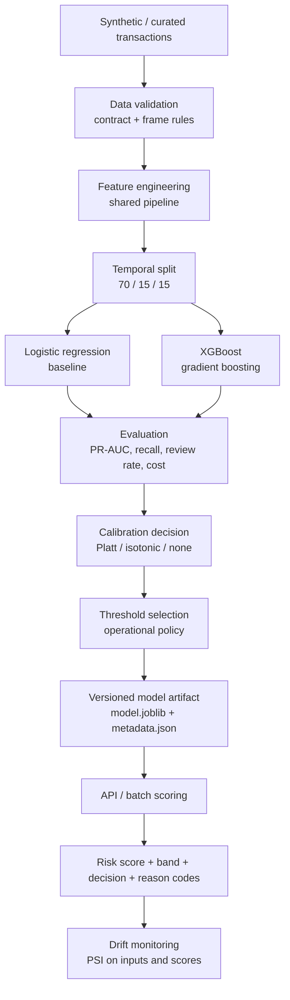
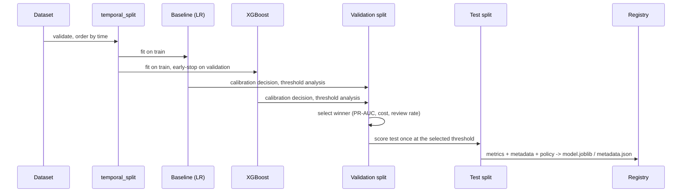

# Architecture

`fraud-detection-ml` is a modular Python package (`src/fraud_ml`) with one feature pipeline
shared by training and inference, a local artifact registry, a Typer CLI and a FastAPI
scoring service. Nothing requires a server, a database or another repository at runtime.

## Flow



## Package layout

| Package | Responsibility | Key modules |
|---|---|---|
| `contracts/` | Versioned Pydantic contracts and closed vocabularies | `transaction.py` (`fraud-transaction/1`), `score.py` (`fraud-score/1`, `RiskPolicy`), `enums.py`, `money.py` |
| `data/` | Loading, frame validation, temporal split, synthetic generator | `loader.py`, `validation.py`, `split.py`, `synthetic.py` |
| `features/` | Deterministic feature derivation and the fitted preprocessing | `definitions.py` (catalogue + forbidden columns), `transaction.py`, `temporal.py`, `velocity.py` (point-in-time history), `behavioural.py`, `pipeline.py` |
| `models/` | Baseline, gradient boosting, calibration, serialization, registry | `baseline.py`, `gradient_boosting.py`, `calibration.py`, `serialization.py`, `registry.py` |
| `training/` | Orchestration, metrics, threshold policy, MLflow | `train.py`, `evaluation.py`, `threshold.py`, `experiment.py` |
| `scoring/` | Scorer, reason codes, batch scoring | `scorer.py`, `explanation.py`, `batch.py` |
| `monitoring/` | Drift, score distribution, data quality snapshots | `drift.py`, `score_distribution.py`, `data_quality.py` |
| `api/` | FastAPI routes, error envelope, model holder, middleware | `routes.py`, `errors.py`, `dependencies.py` |
| `adapters/` | Optional mapping from `txn-data-pipeline` curated output | `txn_pipeline.py` |
| `cli/` | `fraud-ml` command line | `main.py` |
| root | `config.py` (settings, cost model, policy), `logging.py`, `exceptions.py`, `main.py` (ASGI app) | |

## The one feature pipeline

The persisted artifact is a scikit-learn `Pipeline` with three steps:

1. `features`: a stateless `FunctionTransformer(build_feature_frame)` that maps a contract
   frame to the 37 catalogued features. It is pure pandas, deterministic, and raises
   `LeakageError` if a label or post-outcome column is present in its input.
2. `preprocessor`: a `ColumnTransformer` holding the only fitted state (imputation medians,
   scaler statistics, one-hot vocabularies). It is fitted on the training split alone.
3. `model`: `LogisticRegression` or `XGBClassifier`.

A calibration wrapper (`CalibratedClassifierCV` over a `FrozenEstimator`) may surround the
pipeline when the calibration decision says it helps. Scoring code only ever calls
`predict_proba` on the loaded object, so the API, batch scoring and evaluation run the
same code path as training. There is no second preprocessing implementation.

## Training pipeline



Everything that *tunes* (number of trees, calibrator, threshold, priority threshold) sees
only the validation split. The test split is scored once per candidate after all decisions
are fixed, and those are the numbers reported in `metrics.json` and the README.

## Artifact layout

```
models/
├── 20261013T142432Z/      # one directory per training run (run_id = UTC timestamp)
│   ├── model.joblib       # feature pipeline + preprocessing + model (+ calibrator)
│   └── metadata.json      # versions, data hash, policy, metrics, config, artifact SHA-256
└── latest/                # copy of the promoted run; the API loads this directory
```

`fraud_ml.models.registry.load_artifact` refuses an artifact whose input schema, feature
version or score schema differs from the running code, or whose `model.joblib` hash does not
match the recorded one. See [MODEL_GOVERNANCE.md](MODEL_GOVERNANCE.md) and
[SECURITY.md](SECURITY.md).

## Runtime components

* **CLI** (`fraud-ml`): generate-data, train, evaluate, score-file, score, drift-check,
  model-info, serve, demo.
* **API** (`uvicorn fraud_ml.main:app` or `fraud-ml serve`): loads `<model_dir>/latest` at
  startup; `/health/ready` reports whether a valid artifact is loaded.
* **MLflow**: optional local file store (`file:./mlruns`); parameters, metrics, reports and
  metadata are logged per run. MLflow 3 marks the file store as maintenance-only; the
  project opts in explicitly because a zero-infrastructure store is the right choice here.
* **Docker**: one image for both the API and the CLI. On first start the entrypoint trains a
  small bootstrap model from synthetic data when no artifact is mounted.

## What is deliberately not here

No Kubernetes, Kafka, Airflow, Spark, feature store or model registry server. The point is
to show the engineering decisions (contracts, leakage controls, temporal validation,
operational thresholds, versioned artifacts, monitoring outputs) in a form that a reader can
run locally in under a minute, not to showcase infrastructure.
